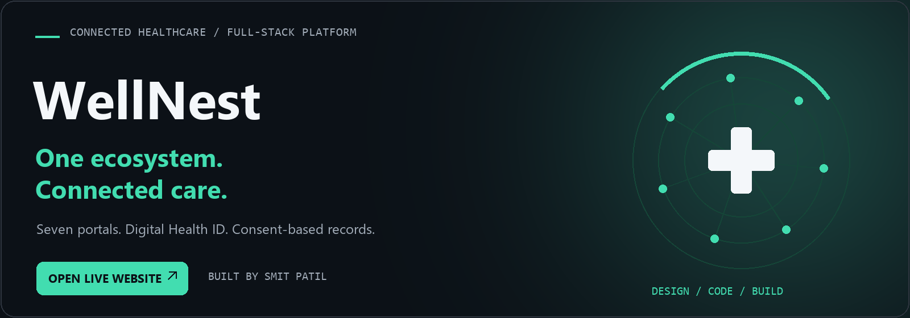
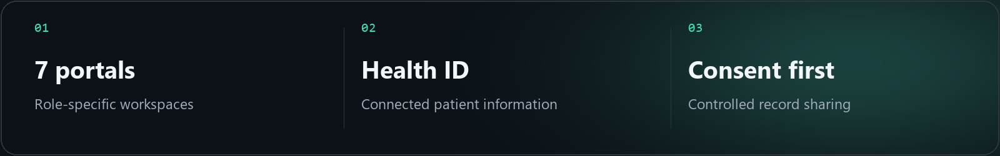

<a href="https://wellnest-healthcare.vercel.app/">

</a>

<div align="center">

**[OPEN LIVE WEBSITE](https://wellnest-healthcare.vercel.app/)** &nbsp; / &nbsp; **[EXPLORE THE PORTALS](#portals-and-workflows)** &nbsp; / &nbsp; **[MEET THE DEVELOPER](https://smit-patil-portfolio-eight.vercel.app/)**

</div>

# WellNest Healthcare

**One ecosystem. Connected care.**

A full-stack healthcare portfolio project that connects patients and care teams through seven dedicated portals. It brings health records, appointments, prescriptions, and consent-based sharing into connected workflows.



## Portals and workflows

| Portal | Main capabilities |
| --- | --- |
| Patient | Health records, timelines, appointments, Health ID, consent and sharing controls |
| Doctor | Patient access requests, availability, consultations and prescriptions |
| Hospital | Organization staff, admissions, records and discharge workflows |
| Laboratory | Orders, report versions, verification and controlled release |
| Pharmacy | Prescription processing, dispensing and inventory |
| Insurance | Policies, supporting documents and claim review |
| Administrator | Professional verification, account management, audit and system health |

The application includes Google sign-in, authenticator-based two-factor authentication, role and organization checks, support/privacy requests, and database-backed scheduling. Visible portal data refreshes on a polling interval and on window focus.

## Stack

| Layer | Technologies |
| --- | --- |
| Interface | React 19, TypeScript, Tailwind CSS 4, Framer Motion |
| Frontend tooling | Vite 7, ESLint |
| Data and identity | Supabase Auth, PostgreSQL, Supabase Storage |
| API and deployment | Vercel serverless API handlers |
| Workflow testing | Node.js test runner and isolated PostgreSQL through PGlite |

## Local development

Use a supported Node.js version compatible with Vite 7 (Node 22.12 or later is a suitable baseline).

```sh
git clone https://github.com/smitpatil1959-design/WellNest-HealthCare.git
cd WellNest-HealthCare
npm ci
```

Copy `.env.example` to `.env.local` and replace its placeholders with your own Supabase project settings. Server credentials must stay server-side; never use a `VITE_` prefix for a service-role key. Configure optional provider settings using `.env.services.example` only when needed.

```sh
npm run dev
```

The development server also serves the local `/api` handlers. Apply the versioned SQL migrations in `supabase/migrations/` in numeric order to a separate development project; read the associated preflight scripts before applying database updates. Use synthetic data and dedicated test accounts.

## Validation

```sh
npm test
npm run build
```

The regression suite checks authorization, consent, scheduling conflicts, portal workflows, delivery guards and local backup restoration. Local fixtures do not establish that external services or production recovery work. The separate live QA runner is mutating, restricted to its allowlisted deployment, and requires explicit setup; `npm test` does not run it.

See [live test coverage](docs/live-demo-test-report.md), [testing procedure](docs/live-demo-testing.md), and [services and recovery](docs/launch-services-and-recovery.md) for the scope and limits of the recorded checks.

## Deployment

Deploy the frontend and API handlers together using `vercel.json`. Configure the intended Supabase project, server service-role key, `VITE_APP_URL` and `PUBLIC_APP_URL` in the hosting environment. Existing public build defaults are deployment-specific; set your own values explicitly. Configure the matching Site URL and allowed authentication return URLs in Supabase before testing Google sign-in or password recovery.

Keep `.env.local`, `.env.services.local`, provider credentials, test-run manifests, backups and `.vercel` metadata out of Git. The committed environment examples contain placeholders only.

## Optional services and current limits

- The email adapter supports Resend. A free own-inbox email test was completed; automatic delivery remains disabled pending approved sender and delivery setup.
- SMS, automatic reminder scheduling and a hosted private file scanner require separate configuration.
- The private scanner gateway is under `services/file-scanner/`; local scanning checks do not establish a deployed scanning service.
- A local database restore drill passed. Production backup and private-storage recovery still need a separate restore environment and verification.
- Support requests do not automatically bypass MFA, delete accounts or determine retention decisions.

This is a portfolio implementation. Its tests and interface do not establish independent regulatory certification or clinical readiness.

---

<p align="center">
Built by <a href="https://github.com/smitpatil1959-design"><strong>Smit Patil</strong></a><br />
Frontend Development Specialist &amp; AI / Software Developer<br /><br />
<a href="https://smit-patil-portfolio-eight.vercel.app/">Portfolio</a> &nbsp; / &nbsp;
<a href="https://www.linkedin.com/in/smitpatil2008/">LinkedIn</a>
</p>
